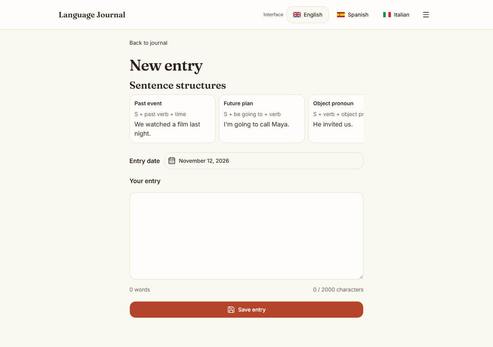
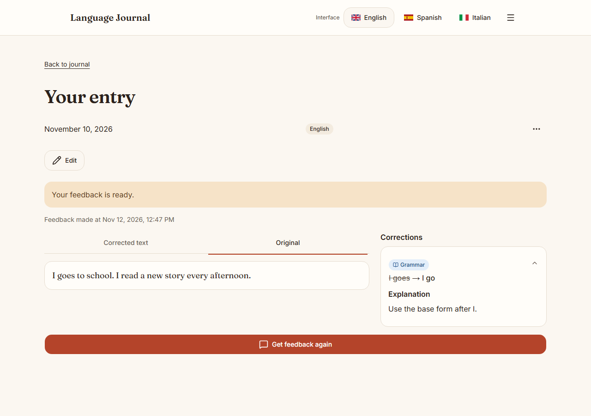
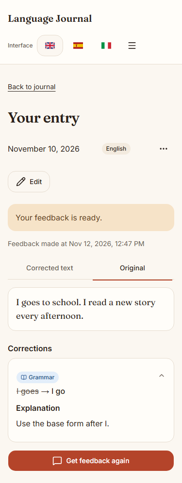
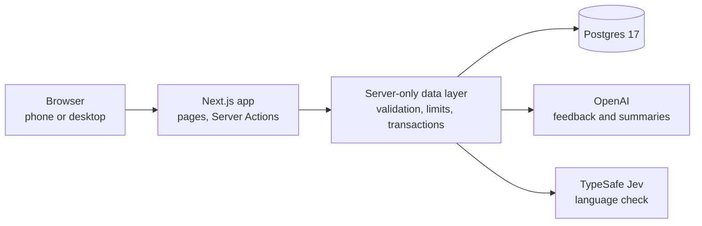

# Language Journal

A personal writing journal for learning English, Spanish or Italian. You write a short entry, get a corrected version with up to three explained corrections, and reopen the entry later. Built as a single-user, local-first app in Next.js, Postgres and the OpenAI API.

Video walkthrough (about six minutes): [watch on Google Drive](https://drive.google.com/file/d/1fgaPH_7YSD6sgUm_6iWj3I9vYD9bJiTS/view?usp=sharing)

Status: working locally for one learner. It has no login and is not meant for public deployment (see [Limits](#limits)).

## Quick start

You need Docker (Docker Desktop on Windows and macOS, Docker Engine with Compose on Linux) and an OpenAI API key. A TypeSafe Jev key is optional and enables the language check.

**1. Create your settings file**

PowerShell (Windows):

```powershell
Copy-Item .env.example .env
```

macOS, Linux or Git Bash:

```sh
cp .env.example .env
```

**2. Add your keys to `.env`**

| Variable            | Needed for                     | Notes                                                                 |
| ------------------- | ------------------------------ | --------------------------------------------------------------------- |
| `OPENAI_API_KEY`    | Feedback and journal summaries | Without it, saving still works and feedback reports a provider error. |
| `JEV_API_KEY`       | Language check while writing   | Optional. Without it, checks are skipped.                             |
| `POSTGRES_PASSWORD` | Local database password        | Change it from the example value if this machine is shared.           |

Keys are read on the server only. They never reach the browser.

**3. Start everything**

```sh
docker compose up --build
```

Open <http://127.0.0.1:3000>. Migrations run automatically on start. Data stays in a Docker volume, so `docker compose down` keeps it.

### Running the app on your machine

With Docker running, Docker starts the database and the app runs on your machine.

Requirements: Node.js 24 or newer, and pnpm 11.6.0 (`corepack enable` activates the pinned version).

```sh
pnpm setup
pnpm dev
```

`pnpm setup` creates `.env` if it is missing, starts the database, waits for it, installs packages and applies migrations. It never overwrites an existing `.env` and never prints key values.

Without Docker, use your own Postgres 17 instead: set `DATABASE_URL` in `.env`, then run `pnpm setup:no-docker` and `pnpm dev`.

### Using the app from a phone

By default the app listens on `127.0.0.1` only. To open it from a phone on your Tailscale network, set `APP_HOST` to this computer's Tailscale address, then open `http://<that-address>:3000` on the phone.

PowerShell:

```powershell
$env:APP_HOST = "100.x.y.z"
pnpm dev
```

## Screenshots


| Writing                                                  | Feedback, desktop                                          | Feedback, phone                                                     |
| -------------------------------------------------------- | ---------------------------------------------------------- | ------------------------------------------------------------------- |
|  |  |  |

## Architecture



- **Next.js 16 (App Router)** renders the pages. Forms call Server Actions, which validate input and call the data layer. One route handler, `POST /api/jev`, serves the live language check.
- **Postgres 17 with Drizzle ORM.** Schema in `src/db/schema.ts`, reviewable SQL migrations in `drizzle/`.
- **Feedback** uses OpenAI `gpt-6-luna` through the Vercel AI SDK with structured JSON output. Every response is validated with Zod before it is saved: JSON shape, exact quoted spans, category values, and the language of the explanations (checked with `eld`).
- **Jev (TypeSafe)** judges whether text is real language before it reaches the feedback model, and gives a quick main-issue check while typing.
- **UI:** Tailwind CSS and shadcn/ui, designed mobile first.

### Single-page behaviour

The brief asks for a single-page application. This is a Next.js app with server-rendered first pages and client components for the interactive parts (writing, feedback status, settings). After the first load, navigation and form submissions happen in the browser without full page reloads, so the learner experiences it as an SPA.

It is not a separate frontend talking to a separate API. I chose one deployable unit so that database access and API keys stay on the server, and there is no API layer to keep in sync. The trade-off is that the first page load is server-rendered, and a strict reading of the brief would count this as a deviation.

## Key decisions and trade-offs

The full reasoning is in [DECISIONS.md](DECISIONS.md).

| Decision                                       | Why                                               | Trade-off                                                       |
| ---------------------------------------------- | ------------------------------------------------- | --------------------------------------------------------------- |
| One Next.js app, not a separate API and SPA    | One deployable unit, one language, less glue code | Not a pure single-page app                                      |
| Save the entry before any AI call              | Writing is never lost if the model fails          | Some entries have no feedback yet                               |
| Structured output, no tool loop                | Output is testable and validated before saving    | The model cannot look up past entries                           |
| Validate every model output before saving      | Bad or unsafe output never reaches the learner    | Validation checks format and quoting, not teaching quality      |
| Hard caps on entries, requests and daily calls | Predictable cost, bounded work                    | Heavy use is blocked by design                                  |
| Small model (`gpt-6-luna`)                     | Bounded task, low cost per entry                  | Less capable on long or complex text                            |
| No login                                       | Scope: one learner on one machine                 | Not safe for public or multi-user use                           |
| Soft delete, with category counts kept         | Mistake patterns survive deletion                 | Trashed entries still use their slots until permanently deleted |
| Language check fails open                      | Writing is never blocked by a third-party outage  | It is a best-effort filter, not a guarantee                     |

## Data and limits

| Limit                       | Value                   | Why                                        |
| --------------------------- | ----------------------- | ------------------------------------------ |
| Entry length                | 2,000 characters        | Keeps each analysis request small          |
| Feedback requests per entry | 3                       | Stops repeated retries becoming a habit    |
| Corrections per feedback    | 3                       | A set the learner can act on               |
| Entries per journal         | 10                      | Keeps each journal reviewable              |
| Model calls per day         | 50 (London day, shared) | Cost brake, covering retries and summaries |
| Language checks per day     | 200                     | Same reason, for Jev                       |

Entries, feedback, usage counts and summaries are stored in Postgres. Deleting an entry is soft by default, and a separate action removes it permanently.

## Testing

```sh
pnpm lint
pnpm typecheck
pnpm test                              # unit tests, fakes only
pnpm db:up && pnpm test:integration    # real Postgres
pnpm exec playwright install chromium
pnpm test:e2e                          # browser tests at phone and desktop widths
```

| Layer                     | Covers                                                               | Does not cover                                   |
| ------------------------- | -------------------------------------------------------------------- | ------------------------------------------------ |
| Unit (`pnpm test`)        | Validation, actions, state changes, prompts                          | Real database, real browser, real model quality  |
| Integration               | Real Postgres: migrations, limits, concurrency, deletion and restore | Browser, live providers                          |
| Browser (`pnpm test:e2e`) | Chromium at 375px and 1280px, feedback states, settings, trash       | Other browser engines, physical phone keyboards  |
| Live (`pnpm test:live`)   | Opt-in calls to OpenAI and Jev                                       | Broad quality evaluation. Skipped unless enabled |

## Evaluation

Feedback quality was checked in three ways. The results are small and specific, not a benchmark.

- **Human review (the author).** The author is a native speaker of Italian and Spanish and is fluent in English. The author used the app on real entries and found the feedback useful, especially in Italian and Spanish. Those two languages were chosen as the main test languages for this reason.
- **AI agent review.** An AI agent with no prior knowledge of the app ran 30 entries through the browser: ten each in English, Spanish and Italian, at Basic (A2) level. All 30 received feedback, and none failed or was refused. The agent rated the quality 4 out of 5 and judged it helpful for learning in part.
- **AI agent review of insights.** The same agent checked the insight card and summary for each journal against its entries. The summaries used real examples and invented nothing. The category counts were wrong in places (for example, Spanish showed 5 grammar corrections where there were 4), and one tie was shown as a clear top category. The agent rated the insights 2 out of 5 before the fix. Both problems were then fixed: the counts use each entry's latest feedback, and ties are shown as ties.

What the reviews found:

- Corrections were mostly right for grammar and spelling, and correct sentences were usually left alone.
- Some over-corrections: a natural phrase was changed without a clear reason (`in her house` to `at her house`).
- One explanation generalised a rule wrongly (`-s` after a singular subject, applied to `I`).
- Some explanations used terms such as `past participle` without a simple example, which is too technical for A2.

Not evaluated: repeated generations for the same text, levels other than A2, retention over time, and the quality of feedback written in each interface language.

## Documentation map

| Where                                                          | What it is for                                                            |
| -------------------------------------------------------------- | ------------------------------------------------------------------------- |
| `README.md`                                                    | This page: setup, architecture, limits                                    |
| `DECISIONS.md`                                                 | Each design question, the choice, the reason and the trade-off            |
| `docs/research/shorthand-reference.md`                         | Research behind the informal-language examples used by the language check |
| `docs/database-roles.md`                                       | Optional least-privilege database roles                                   |
| `docs/stage2-live-results.md`, `docs/jev-gate-live-results.md` | Recorded samples from live provider calls                                 |
| `docs/screenshots/current/`                                    | Four screenshots used above                                               |
| `scripts/`                                                     | Setup and test helpers                                                    |
| `drizzle/`                                                     | Database migrations                                                       |

## Limits

- **Single user.** Data and settings have no user association.
- **No authentication or ownership checks.** Anyone who can reach the app can use it. Before any public deployment, add login and check ownership in every action and route.
- **Quality is reviewed, not measured.** See [Evaluation](#evaluation). The review covered 30 entries at A2 and found over-corrections and some over-technical explanations.
- **No durable job queue.** Feedback runs after the response. A request that stalls is marked failed after two minutes and can be retried.
- **Summary language is a prompt rule.** The code checks that a summary exists and fits its length, not that it follows the language instructions.
- **Trash counts toward the 10-entry limit** until an entry is permanently deleted.
